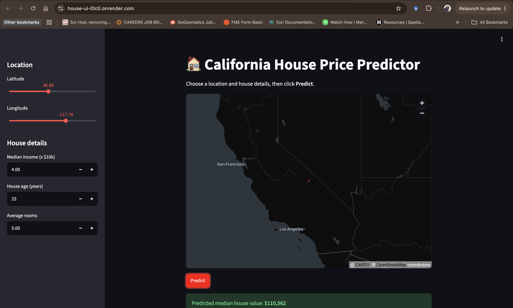

# California House Price Predictor


An end-to-end machine learning service that predicts California house values from location and housing features. A Random Forest model is served through a FastAPI REST API, with an interactive Streamlit map interface. Both services are containerized with Docker and run together with a single command.

**Live demo:** https://house-ui-l0c0.onrender.com
**API docs:** https://house-price-ml-nb1a.onrender.com/docs

> Hosted on Render's free tier, so the first request after a period of inactivity may take up to a minute while the services wake up.



## Architecture

```
Browser → Streamlit UI (:8501) → FastAPI (:8000) → Random Forest model
In production, each service runs as a separate Docker web service on Render, with automatic redeploys on every push to `main`.
```

Docker Compose runs the UI and API as separate containers on a shared network. The UI reaches the API by its service name, configured through an environment variable.

## Quick start

Requires only [Docker](https://www.docker.com/products/docker-desktop/).

```bash
git clone https://github.com/elkh27/house-price-ml.git
cd house-price-ml
docker compose up --build
```

- Web app: http://localhost:8501
- API docs: http://localhost:8000/docs

## Model

- **Algorithm:** Random Forest Regressor (scikit-learn)
- **Data:** California Housing dataset (20,640 census block groups)
- **Features:** median income, house age, average rooms, latitude, longitude
- **Test set results:** MAE = 0.376, R² = 0.763

Location is a strong predictor: with all other inputs equal, coastal locations such as San Francisco are predicted much higher than inland cities such as Fresno.

## API

`POST /predict`

```json
{
  "MedInc": 4.0,
  "HouseAge": 25,
  "AveRooms": 5.0,
  "Latitude": 34.05,
  "Longitude": -118.24
}
```

Returns `{"predicted_value_usd": ...}`. Inputs are validated with Pydantic; out-of-range values return HTTP 422.

`GET /health` returns service status.

## Testing and CI

API tests use pytest and FastAPI's TestClient. GitHub Actions runs the tests and builds both Docker images on every push.

```bash
cd api && python -m pytest -v
```

## Project structure

```
├── training/train.py        # model training script
├── api/                     # FastAPI service + Dockerfile + tests
├── ui/                      # Streamlit app + Dockerfile
├── docker-compose.yml
└── .github/workflows/ci.yml
```

## Next steps

- Add automated tests for the Streamlit UI
- Add model versioning and experiment tracking
- Add request logging and monitoring